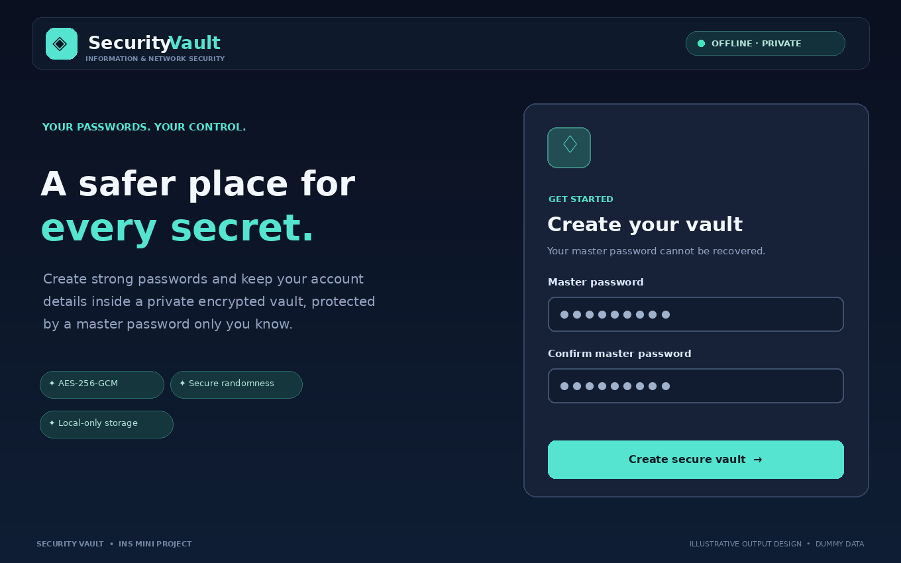
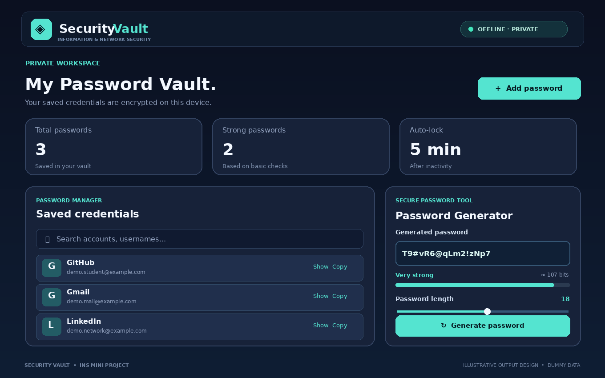
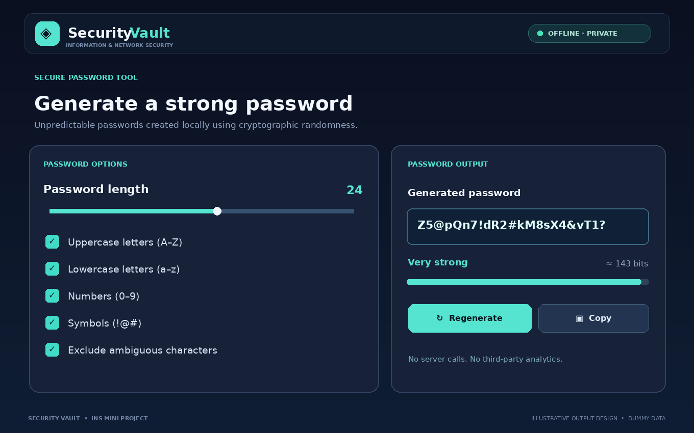
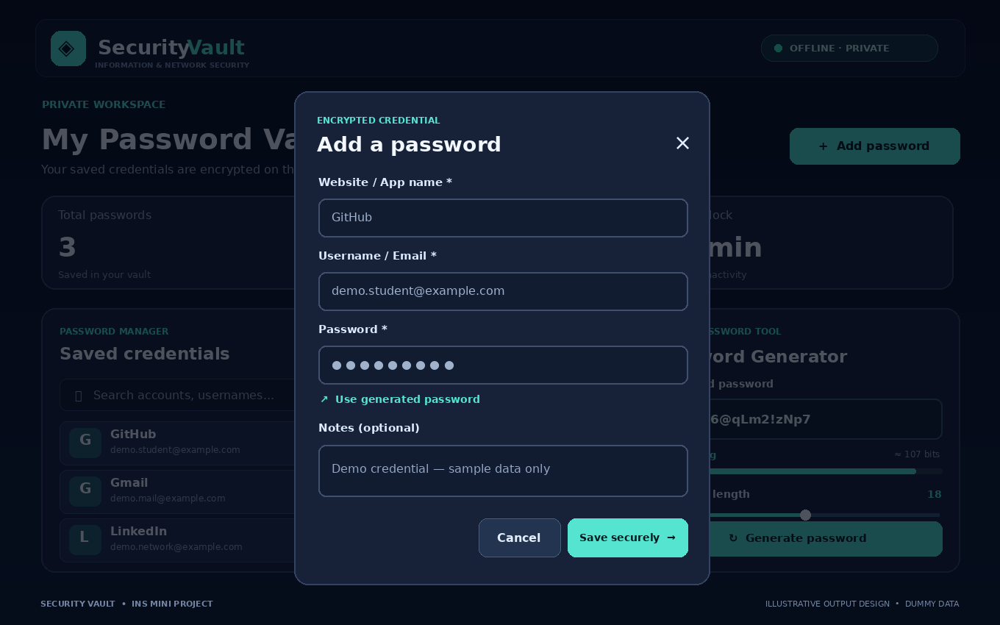

# 🔐 Security Vault

### Information and Network Security Mini Project

A secure password generator and encrypted
password management application developed
using HTML, CSS, and JavaScript.

## 📸 Project Screenshots

### 1. Secure Login Page

### 2. Security Vault Dashboard

### 3. Password Generator

### 4. Password Manager

## 🛠️ Technologies Used
- HTML5
- CSS3
- JavaScript
- Web Crypto API
- AES-256-GCM Encryption
- PBKDF2 Key Derivation

## 🔒 Security Notice
This project is developed for educational
purposes. Use dummy credentials for testing.
